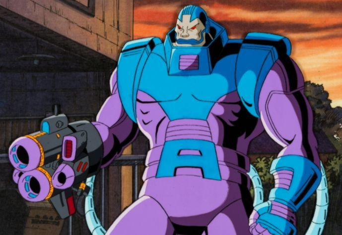
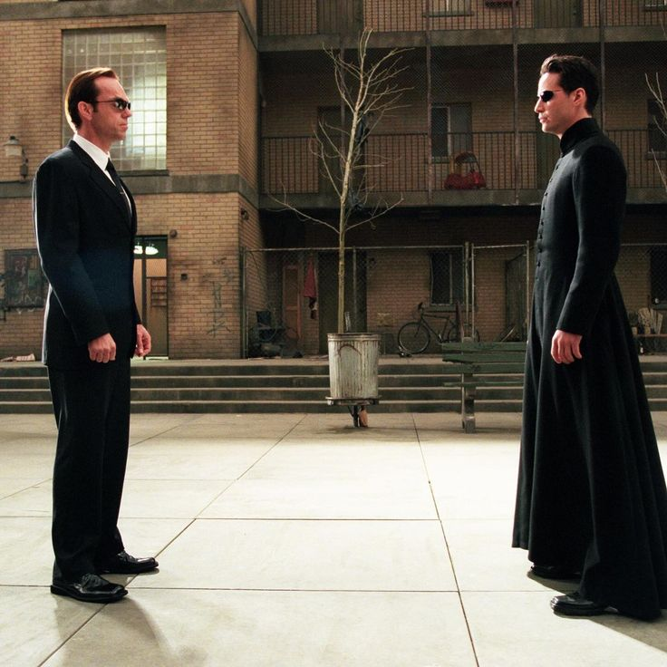
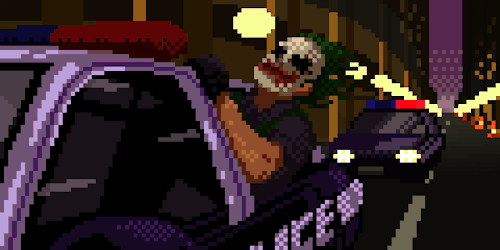

<!-- ═══════════════════════════  OPENING CREDITS  ═══════════════════════════ -->

<p align="center">
  
</p>

<p align="center">
  <a href="https://git.io/typing-svg">
    
  </a>
</p>

<p align="center">
  <a href="https://www.linkedin.com/in/ocampojavieralfonso/"></a>
  <a href="https://javieroc.github.io/portfolio-astro/"></a>
  
</p>

---

## 🎬 Scene One

```text
FADE IN:

INT. HOME OFFICE — NIGHT

A single monitor glows in the dark. Terminal open. Coffee cold.

JAVIER, a Full Stack Developer, leans in. On screen: a stack trace
that would make lesser engineers flee the Lonely Mountain.

                          JAVIER
            Appearances can be deceiving.
            Let's find out what you really are.

He types. The bug doesn't stand a chance.

CUT TO:
```

I build **scalable, high-performance applications** end to end — from the database schema to the last pixel.
What started as curiosity became an obsession with problem-solving, clean architecture, and learning something new every day.

Off-screen, I study the greats: the villains. The best ones have **vision, discipline, and a plan** (except one clown — more on him below).

---

## 🎞️ Now Showing — *Workahomie*

<table>
  <tr>
    <td width="120" align="center">🏠<br/><sub><b>IN PRODUCTION</b></sub></td>
    <td>
      <b>Couchsurfing… for workspaces.</b><br/>
      An app that connects professionals with shared occupations who want to work side by side for a day.
      Hosts open their homes, guests bring their laptops, everyone ships.
    </td>
  </tr>
</table>

---

## ⚔️ The Arsenal

<table>
  <tr>
    <th align="left">🐉 Smaug's Hoard <sub>— Languages</sub></th>
    <td></td>
  </tr>
  <tr>
    <th align="left">🕶️ The Construct <sub>— Frontend</sub></th>
    <td></td>
  </tr>
  <tr>
    <th align="left">🔺 En Sabah Nur's Pyramid <sub>— Backend</sub></th>
    <td></td>
  </tr>
  <tr>
    <th align="left">💰 The Vault <sub>— Databases</sub></th>
    <td></td>
  </tr>
  <tr>
    <th align="left">🃏 Agents of Chaos <sub>— DevOps & Tools</sub></th>
    <td></td>
  </tr>
</table>

---

## 🦹 Hall of Villains

> *"You either die a hero, or you live long enough to see yourself become the villain."*
> Here are the ones who taught me something about code.

<table>
  <tr>
    <td align="center" width="45%">
      
      <br/><b>SMAUG</b><br/><sub><em>The Hobbit: The Desolation of Smaug</em></sub>
    </td>
    <td>
      <blockquote>"There is something about you. Something you carry. Something made of gold. But far… more… precious!"</blockquote>
      <blockquote>"The coward Oakenshield has weighed the value of your life and found it worth nothing."</blockquote>
      <blockquote>"I am fire. I am… <b>DEATH!</b>"</blockquote>
      <sub>💡 <b>Dev lesson:</b> guard your data like a dragon guards gold — validate every input that wanders into your mountain.</sub>
    </td>
  </tr>
  <tr>
    <td>
      <blockquote>"Time is motion, and motion and thought are unity. Two aspects of a single power that is beyond comprehension to all but myself. That is why certain psychics can see into the future. The mind can transcend time!"</blockquote>
      <sub>💡 <b>Dev lesson:</b> async is just time and motion — master the event loop and you can see the future.</sub>
    </td>
    <td align="center" width="45%">
      
      <br/><b>APOCALYPSE</b><br/><sub><em>X-Men: Apocalypse</em></sub>
    </td>
  </tr>
  <tr>
    <td align="center" width="45%">
      
      <br/><b>AGENT SMITH</b><br/><sub><em>The Matrix Reloaded</em></sub>
    </td>
    <td>
      <blockquote>"But, as you well know, appearances can be deceiving, which brings me back to the reason why we're here. We're not here because we're free. We're here because we're not free. There is no escaping reason; no denying purpose. Because as we both know, without purpose, we would not exist."</blockquote>
      <sub>💡 <b>Dev lesson:</b> every function needs a purpose — and once you find a good pattern, replicate it everywhere.</sub>
    </td>
  </tr>
  <tr>
    <td>
      <blockquote>"Do I really look like a guy with a plan? You know what I am? I'm a dog chasing cars. I wouldn't know what to do with one if I caught it! You know, I just… <em>do</em> things."</blockquote>
      <sub>💡 <b>Dev lesson:</b> this is how <i>not</i> to ship to production. Have a plan. Write the tests. 🃏</sub>
    </td>
    <td align="center" width="45%">
      
      <br/><b>THE JOKER</b><br/><sub><em>The Dark Knight</em></sub>
    </td>
  </tr>
</table>

---

## 📊 Box Office

<p align="center">
  
  <br/>
  
  
</p>

---

## 📜 End Credits

<p align="center">
  <b>Starring</b> Javier Ocampo &nbsp;•&nbsp; <b>Written in</b> TypeScript & Python &nbsp;•&nbsp; <b>Filmed on</b> Linux<br/>
  <sub>No dragons, mutants, programs, or clowns were harmed in the making of this profile.</sub>
</p>

<p align="center">
  <a href="https://www.linkedin.com/in/ocampojavieralfonso/">LinkedIn</a> &nbsp;·&nbsp;
  <a href="https://javieroc.github.io/portfolio-astro/">Portfolio</a>
</p>

<p align="center">
  
</p>
